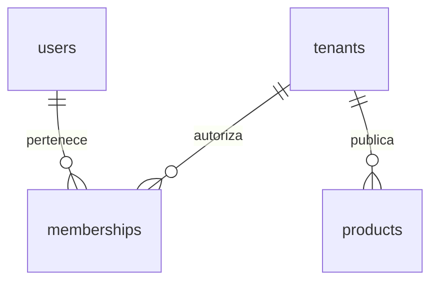

# Modelo implementado

Users/sessions/password_reset_tokens y MFA provienen del starter. Tenants: id, slug único, nombre, activo, created_at UTC. Memberships: PK(tenant_id,user_id), rol owner/cashier/warehouse. Solo owner tiene operaciones de catálogo en esta entrega. Products: id, tenant_id obligatorio, SKU único por empresa, nombre, precio en céntimos bigint no negativo, publicado, created_at UTC. No hay stock implícito ni pago implícito.

Productos usan RLS de lectura/escritura con FORCE. No se han creado todavía pedidos, pagos ni inventario; sus estados independientes se implementarán con sus flujos y restricciones.
