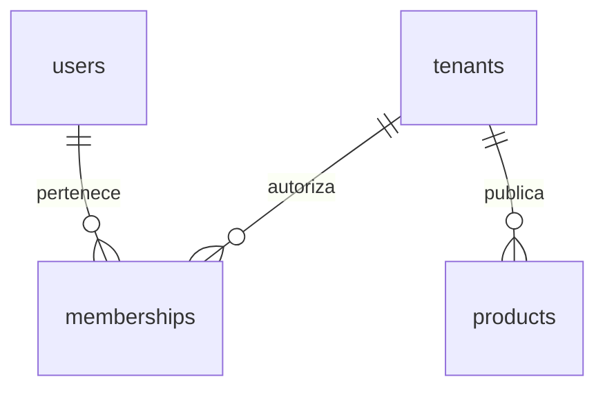

# Modelo implementado

Users/sessions/password_reset_tokens y MFA provienen del starter. Tenants: id, slug único, dominio personalizado único opcional, nombre, activo, plan, configuración JSON y created_at UTC. La identidad visual versionada incluye portada, logo, redes, colores, orden de secciones, horario, métodos/tarifas de entrega y cupón destacado. Memberships: PK(tenant_id,user_id), rol owner/cashier/warehouse. Products: id, tenant_id obligatorio, SKU único por empresa, nombre, grupo de variante, talla, color, categoría, audiencia, precio en céntimos bigint no negativo, promoción, publicación e imagen. Cada SKU es una variante vendible y se relaciona con posiciones de inventario independientes por almacén.

Productos, inventario, clientes, pedidos y libros operativos usan RLS de lectura/escritura con FORCE. Pedidos, pagos, entrega e inventario mantienen estados separados; las ventas confirmadas se compensan y no se borran. Cada pedido congela el método elegido (`pickup`, `delivery`, `courier` o `shipping`) y su tarifa en céntimos. `order_events` conserva de forma inmutable cada transición del pedido. `customer_notifications` replica los eventos visibles para el usuario asociado al cliente; la aplicación actualiza `read_at` dentro del contexto RLS de la tienda.

Migración 000015: memberships.role e invitations.role aceptan catalog además de owner/cashier/warehouse. invitations añade revoked_at y last_sent_at; no se borra su historial ni se almacena el token en claro. Cada asistencia de catálogo utiliza una membresía ordinaria vinculada a tenant_id y cuenta dentro del límite de usuarios del plan.
